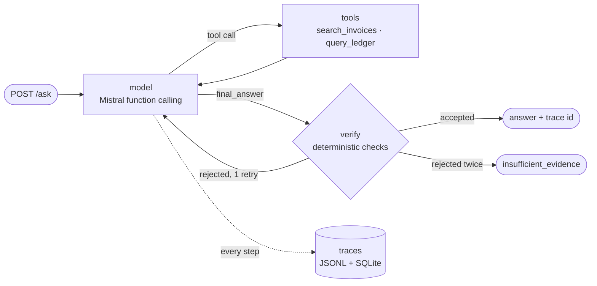

# invoice-recon-agent

An agent that answers accounts-payable questions such as *"Has supplier Dupont's March invoice
been paid, and does the bank amount match?"*. It retrieves the invoice, verifies it against the
bank ledger, and refuses to answer when the evidence does not support an answer.

**On a held-out test set it scores 89.8% (baseline 79.6%), at a median
2.9 s and $0.63 per 1,000 requests with `mistral-small-latest`.**
Every number in this README is reproducible with the command next to it.

> **The data is synthetic.** It is generated from fixed seeds, so every evaluation question has a
> known correct answer. It contains deliberate traps: split payments, partial payments, payments
> of the pre-VAT (HT) amount only, duplicate invoice copies, payments without a reference, and
> suppliers with near-identical names (Dupont SARL / Dupond SAS).

## Architecture



- **LangGraph** state machine with three nodes. The model must answer through tool calls
  (`tool_choice="any"`), so the final answer is a typed `final_answer` call, not free text.
- **Tools** (`recon/tools.py`), with Pydantic-typed inputs and outputs:
  - `search_invoices`: BM25 over invoice documents, with supplier and month filters.
    Lexical retrieval is deliberate: invoice numbers and supplier names are exact identifiers.
  - `query_ledger`: parameterised SQL on a **read-only** SQLite connection; the model supplies
    values, never SQL.
- **Verifier** (`check_answer` in `recon/agent.py`): every claim must come from tool output seen
  in this run. Cited invoices and transactions must have been returned; amounts must add up; the
  status must follow from the amounts; payments must go to the named supplier, must not reference
  another invoice, and must not predate the invoice; "unpaid" needs a ledger search that could have
  found an unreferenced payment. A rejected answer goes back to the model with every problem
  listed. On the second rejection the agent refuses.
- **Limits**: step budget (8 model calls), 60 s request deadline, provider retries with backoff
  on 429/5xx (full jitter), a process-wide rate limiter on model calls, one retry after a
  malformed tool call or a prose reply.
- **Tracing** (`recon/tracing.py`): one record per request (every step's arguments, result
  summary, latency, tokens, cost), written by a background thread to `traces/traces.jsonl` and
  `traces/traces.db`. `GET /trace/{id}` returns it.

## Evaluation

48 dev questions (seed 42) were used to find and fix failures; 49 **held-out** test questions
(seed 7, different invoices and ledger) were run once, after the agent was frozen.

| set | agent | accuracy | wrong answers | refusals | model calls / q | P50 / P95 latency | $ / 1k req |
|---|---|---|---|---|---|---|---|
| dev | v1 | 79.2% | 10 | 0 | 3.00 | 2.4 / 3.6 s | 0.46 |
| dev | v2 | 85.4% | 2 | 5 | 3.73 | 2.7 / 4.1 s | 0.72 |
| dev | v3 | 91.7% | 1 | 3 | 3.19 | 2.6 / 3.7 s | 0.59 |
| dev | v4 | 97.9% | 0 | 1 | 3.31 | 2.6 / 5.6 s | 0.62 |
| **test** | v1 | 79.6% | 10 | 0 | 2.86 | 2.4 / 2.9 s | 0.43 | |
| **test** | **v4** | **89.8%** | 4 | 1 | 3.37 | 2.9 / 4.6 s | 0.63 | |

```bash
python -m recon.evaluate --version v4                          # dev set
RECON_DATASET=test python -m recon.evaluate --version v4       # held-out set
```

Each failure is classified from the trace (`missed_invoice`, `wrong_invoice`, `false_match`,
`missed_payment`, `overcounted_payment`, `wrong_status`, `refused`, ...). The full per-question
results are in `eval/results/`. Cost uses Mistral's list price ($0.10 / $0.30 per 1M input /
output tokens; check before quoting).

### What broke, and what changed

Each version fixes one failure class found by reading the traces:

| version | failure seen in traces | fix |
|---|---|---|
| v1 → v2 | 7 payments missed: the model searched the ledger only by invoice number, and some bank labels have none. The verifier could not catch it, because it checks the evidence that was cited, and nothing was cited. | Prompt: labels may omit references. **Verifier: "unpaid" is rejected unless the ledger was searched by counterparty or amount.** A claim of absence needs a search that could have found the payment. |
| v1 → v2 | 3 invoices "not found": "the March invoice" became `issue_month: 2025-03`. | Prompt: a month without a year means the current year. |
| v2 → v3 | 4 refusals on HT-only payments: the verifier reported one inconsistency per rejection, so the model ran out of retries fixing them one at a time. | **Verifier judges the status from the cited payments and states the complete correction in one message.** Prompt: HT-only payment means VAT is still owed. |
| v2 → v3 | 1 confident wrong answer: no Martin & Fils invoice existed, so the model answered about Martin Freres. It passed the verifier because it was internally consistent. | Verifier: the invoice must belong to the supplier (or invoice number) named in the question; cited payments must go to that supplier and must not reference another invoice. |
| v3 → v4 | 1 confident wrong answer: the model widened its date window and counted a payment made a week **before** the invoice was issued. | Verifier: payments dated before the invoice are rejected. |

On the held-out set v4 scores 89.8%, 8 points below its 97.9% on dev: that gap is the
overfitting to the dev questions, and the reason the test set exists. 3 of its 4 wrong answers
are `overcounted_payment`, the per-invoice matching limitation listed below. They were reported,
not tuned away.

v2 traded wrong answers for refusals (10 wrong → 2 wrong + 5 refused). Refusing is the safer
failure for an accounting tool, and v3 then won most of those refusals back. v4 bought its last
gain with tail latency: P95 rose to 5.6 s because more answers need a correction round.

### Annotated trace

Dev Q037 under v4, *"How much is still owed to Martin & Fils for their April 2026 invoice?"*
(expected: unpaid). This is the v3 failure, now caught by the v4 rule.

```
[0] llm      984 ms  -> search_invoices(supplier="Martin & Fils", issue_month="2026-04")
[1] tool     0.8 ms     1 hit: MAF-2026-0004 Martin & Fils TTC 9716.02
[2] llm      474 ms  -> query_ledger(counterparty="Martin & Fils", date_from="2026-04-12")
[3] tool     1.0 ms     0 transactions                      # issued 12 April: nothing paid since
[4] llm     1388 ms  -> query_ledger(counterparty="Martin & Fils", date_from="2026-04-01", ...)
[5] tool     1.2 ms     1 txn: TXN-00066 MARTIN & FILS 9337.56   # the model widened the window
[6] llm     1879 ms  -> final_answer(status="partially_paid", paid_amount=9337.56, ...)
[7] verify  REJECTED: TXN-00066 is dated 2026-04-05, before the invoice was issued
            (2026-04-12): it cannot be a payment of this invoice
[8] llm      915 ms  -> final_answer(status="unpaid", paid_amount=0.0, ...)
[9] verify  ok                                    5.65 s, 5 model calls, 8,086 tokens, $0.0009
```

The model time (5.6 s) dwarfs the tool time (3 ms). That is why the load test is run twice.

## Load test

Locust against the FastAPI service (one uvicorn process) on a Windows laptop (8 logical CPUs). A request counts
as an error if HTTP fails **or** the agent ends in `error`, `timeout` or `step_limit`.

**1. Mocked model, 0 ms**: the service's own overhead, the part this code controls.

| users | req/s | P50 | P95 | errors |
|---|---|---|---|---|
| 1 | 16.4 | 9 ms | 14 ms | 0% |
| 5 | 72.2 | 15 ms | 38 ms | 0% |
| 10 | 101.4 | 42 ms | 99 ms | 0% |
| 20 | 110.2 | 120 ms | 210 ms | 0% |

The first run topped out at 46 req/s (P50 360 ms at 20 users). Profiling showed half of each
request was spent writing its trace: open SQLite, commit, close, all under a global lock, so every
request queued behind every other's write. Moving writes to a batching background thread made the
service **2.4× faster at 20 users** (46 → 110 req/s). The remaining overhead is mostly LangGraph
orchestration (about 9 ms per request) and Python's GIL. Results are in
`loadtest/results/mock-0ms_sync-traces` (before) and `mock-0ms_async-traces` (after).

**2. Mocked model, 800 ms per call**: realistic latency, no provider limits.

| users | req/s | P50 | P95 | errors |
|---|---|---|---|---|
| 1 | 0.38 | 2.4 s | 3.2 s | 0% |
| 20 | 7.53 | 2.4 s | 3.2 s | 0% |

Latency stays at 3 × 800 ms from 1 to 20 users and throughput scales linearly: the synchronous
agent runs in FastAPI's thread pool, so waiting on the model blocks nothing else. That pool
defaults to 40 threads; beyond 40 concurrent requests they would queue.

**3. Real model (`mistral-small-latest`)**: end to end, including the provider's rate limits.

*Before: no client-side limiter* (30 s per level)

| users | successful req/s | P50 | P95 | errors |
|---|---|---|---|---|
| 1 | 0.34 | 3.0 s | 4.3 s | 0% |
| 5 | **1.64** | 2.9 s | 4.4 s | 0% |
| 10 | 0 | 8.7 s | 9.6 s | **100%** |
| 20 | 0.71 | 9.6 s | 14.0 s | **68%** |

Every error was HTTP 429 *Rate limit exceeded* (read from the traces), raised on the first model
call after three retries. Between 5 and 10 users the free tier went from 0% to 100% errors: every
thread backed off and retried at about the same moment, so backing off did not help.

*After: a shared rate limiter at 2 model calls/s* (60 s per level)

| users | successful req/s | P50 | P95 | errors |
|---|---|---|---|---|
| 1 | 0.34 | 2.9 s | 4.9 s | 0% |
| 5 | 0.59 | 7.8 s | 12 s | 0% |
| 10 | 0.47 | 18 s | 35 s | **0%** |
| 20 | 0.39 | 38 s | 51 s | **0%** |

`RateLimiter` in `recon/llm.py` is a process-wide token bucket: each model call reserves the next
free slot under a lock and sleeps until it comes up, so calls are served in arrival order instead
of stampeding the provider. Retries spend quota too, and 429 backoff now uses full jitter. Each
trace records how long every call waited in the queue (`wait_ms`).

What the numbers say:

- **Errors became latency.** Zero failed requests at every level, but latency now grows with
  concurrency, as a queue does: at 20 users 79% of request time is spent waiting for a slot. At
  P95 51 s, 20 users is close to the 60 s request deadline; beyond about 25 users requests would
  start timing out instead of queueing.
- **Peak throughput went down**: 0.59 req/s instead of 1.64 at 5 users. The unlimited run was
  riding a provider-side burst allowance over a short window; 2 calls/s is what holds for a
  minute or more. (Successful req/s at 10 and 20 users reads below the 0.6 req/s cap because
  requests still queued when a 60 s level ends are not counted.)
- **Calibration took two tries.** I first set 4 calls/s from the burst run, and that still failed
  19% of requests at 10 users (`loadtest/results/mistral_limiter-4rps`). At 2 calls/s, 8% of calls
  still received a 429, but the jittered retries absorbed all of them. The provider's sustained
  limit is somewhere between 1 and 2 calls/s, with bursts on top.
- **The ceiling is the provider quota, not this service**, which handled 110 req/s with a mocked
  model. Going further needs a paid tier, fewer model calls per question, or both.

```bash
python -m loadtest.run --llm mock
python -m loadtest.run --llm mock --mock-latency-ms 800
RECON_LLM_RPS=0 python -m loadtest.run --llm mistral --duration 30   # before: no limiter
python -m loadtest.run --llm mistral --duration 60                   # after: 2 calls/s (default)
```

## Run it

```bash
python -m venv .venv
.venv/Scripts/activate          # Windows; `source .venv/bin/activate` elsewhere
pip install -r requirements-dev.txt
cp .env.example .env            # add MISTRAL_API_KEY
python -m recon.data_gen        # dev set; RECON_DATASET=test for the held-out set
python -m recon.cli "Has supplier Dupont's March invoice been paid, and does the bank amount match?"
python -m recon.cli --mock "Is invoice DUP-2026-0003 from Dupont fully paid?"    # no API key needed
pytest -q                       # 45 tests, no API calls
```

API:

```bash
uvicorn recon.api:app --port 8000
curl -X POST localhost:8000/ask -H "Content-Type: application/json" \
     -d '{"question": "Is invoice DUP-2026-0003 from Dupont fully paid?"}'
curl localhost:8000/trace/<request_id>
```

Docker:

```bash
docker build -t invoice-recon-agent .
docker run --rm -p 8000:8000 --env-file .env invoice-recon-agent
```

## Known limitations

- **Synthetic data, small sets.** 48 dev and 49 test questions: one question is about 2 points of
  accuracy, so differences of a few points are within noise. The traps are ones I designed, so the
  real-world error rate on messy bank data would be higher.
- **The dev set was used for tuning** (v1 → v4); only the test-set numbers are unbiased.
- **Payments are matched one invoice at a time.** An unreferenced payment is never assigned
  globally across all of a supplier's invoices, so one payment could be claimed by two invoices
  in separate requests. A proper fix is a reconciliation pass that solves the assignment for the
  whole ledger.
- **Supplier grounding is lexical**: the invoice's supplier name, minus its legal form, must
  appear in the question. A question that uses an abbreviation or trading name would be refused.
- **Counterparty matching is exact** after normalisation; real banks truncate and alter names.
- **Trace durability**: traces are written asynchronously; records still queued at a hard crash
  are lost.
- **The Docker image was not built on the development machine** (no Docker installed there).
- **Not covered**: authentication, multi-tenancy, a frontend, deployment, a managed vector
  database, multi-agent setups and fine-tuning.

## Layout

```
recon/
  data_gen.py   synthetic invoices, ledger, questions (seeded)
  retrieval.py  BM25
  tools.py      typed tools + JSON schemas for function calling
  llm.py        Mistral client, mock and scripted models
  agent.py      LangGraph agent, prompts v1–v4, verifier
  tracing.py    trace records, async JSONL + SQLite store
  evaluate.py   eval harness and failure classification
  api.py        FastAPI service
  cli.py        one question from the terminal
loadtest/       Locust user and runner
eval/           questions and results
tests/          45 offline tests
```
